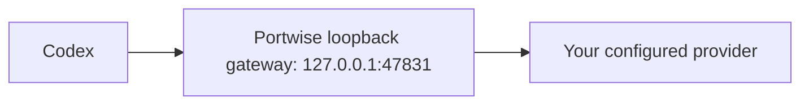

<p align="center">
  
</p>
<h1 align="center">Portwise</h1>
<p align="center"><strong>Codex accounts and providers, routed through one local gateway.</strong></p>
<p align="center">
  <a href="#install">Install</a> · <a href="#quick-start">Quick Start</a> · <a href="#security-and-limits">Security</a> · <a href="#troubleshooting">Troubleshooting</a>
</p>
<p align="center">
  <a href="https://github.com/GitHubsantu/portwise/actions/workflows/ci.yml"></a>
  <a href="https://github.com/GitHubsantu/portwise/blob/main/LICENSE"></a>
  <a href="https://www.typescriptlang.org/"></a>
</p>
<p align="center">Marketplace: not published yet</p>

> [!NOTE]
> Portwise is an independent community extension. It is not affiliated with, endorsed by, or sponsored by OpenAI or Microsoft. It is not a fork of any other project. “Codex” describes compatibility only.

## Why Portwise

Keep provider profiles, saved logins and gateway troubleshooting in one VS Code panel. Starting the gateway does not edit your Codex files; configuring Codex is a separate, confirmed operation.

| | What you get |
| :--- | :--- |
| 🔀 **Provider profiles** | Add, edit, test, enable and remove endpoints; enter tokens through VS Code's password input. |
| **Saved accounts** | Save file-store login snapshots and switch explicitly, without changing history or sessions. |
| **Local gateway** | A configurable port, stable local token and detached daemon that survives extension-host restarts. |
| **Measured diagnostics** | Separate extension, gateway and upstream hints, plus an explicit redacted-copy action. |

## Install

**Requirements:** VS Code **1.106.0 or newer**. Install the official Codex tooling separately; account login and the usage terminal require `codex` on your PATH. Windows, macOS and Linux are targets; CI verifies Windows and Ubuntu.

Marketplace installation is pending. To build and install a local VSIX, use Node.js **22** from [`.nvmrc`](.nvmrc); the development packaging tool requires Node 22. The extension's declared runtime minimum remains Node 20.19:

```sh
npm ci --ignore-scripts
npm run verify
code --install-extension ./portwise-0.1.0.vsix
```

You can also choose **Extensions → … → Install from VSIX…** and select the built package. No publishing account is needed for local installation.

## Quick Start

1. **Choose the target and add a provider.** Set `portwise.codexHome` to an existing real directory—use a disposable copy for a first test. Open **Portwise: Open Panel**, select **Add provider**, and enter its URL and token. Non-loopback providers require HTTPS.
2. **Start and configure.** Run **Portwise: Start Gateway**, then **Portwise: Configure Codex for Gateway**. Read the exact canonical path in the confirmation. Configuration adds Portwise's managed settings and local-token delivery; it does not select `model_provider` for you.
3. **Switch deliberately and check.** Run **Portwise: Switch Codex to Portwise Gateway** if you want Codex to use it, confirm the path, then run **Portwise: Run Diagnostics**. Use **Copy redacted report** in the resulting notification when needed.

> [!WARNING]
> Restart Codex/VS Code after changing the delivered gateway token or switching accounts. Matching `.env` bytes cannot prove what an already-running Codex process loaded.

> [!IMPORTANT]
> Account save/switch supports only an explicitly configured **file credential store**. Keyring, auto, ephemeral and unknown modes are refused. Add accounts through **Portwise: Add Account via Codex Login**; each saved snapshot requires a fresh official login launch. A launch is not proof that login completed.

## How it works



`47831` is the default, configurable port. The gateway checks the local token and replaces it with the configured provider token upstream. Provider requests use HTTPS, except explicitly configured loopback HTTP endpoints. The extension host manages profiles and controls the separate daemon; Codex talks directly to that daemon.

## Security and limits

| Implemented handling | Boundary to keep in mind |
| :--- | :--- |
| Gateway binds to `127.0.0.1`; checks Host/Origin and local authentication. | It is for local use, not remote hosting or sharing. |
| Fresh exact-path confirmation before every config/`.env` write operation. | One Configure approval covers that invocation's config + `.env` operation; account/login consent is separate. |
| Timestamped pre-write config/`.env` backups; retains 10 per file and Codex home in extension storage. Restore makes a safety backup. | Backups may contain existing private file contents; private permissions are applied before writing them. |
| Account snapshots and provider tokens are stored in VS Code `SecretStorage`. | The active account still lives in Codex's `auth.json`; the local gateway token is delivered through `.env`. |
| `.env` replacements receive verified private Windows ACLs (0600 mode on POSIX); failure blocks that file's commit. | Earlier steps in a Configure operation may already have completed. Diagnostics checks permissions without repairing them. |
| No quota reads from `auth.json`, no undocumented quota calls and no Portwise telemetry. | File-store account operations/current matching do read credentials in host memory. The panel receives names/ids/current flags, never snapshots. |
| Diagnostics reads current files and probes the local gateway plus the configured provider's models endpoint. | It sends no prompts/code. Windows directory write access is **not proven** by these read-only checks; restart remains necessary. |

These are implementation choices, not an absolute security guarantee. See the [threat model](docs/SECURITY.md), [architecture](docs/ARCHITECTURE.md) and [decisions](docs/DECISIONS.md).

### Known limits for 0.1.0

- A configured provider can return any response content, including content that reflects information it received. Portwise does not rewrite upstream response bodies.
- File updates are verified and guarded rollback preserves external edits. A persistent OS or I/O failure, external edit, or power loss can still require manual recovery from the retained private backup.
- Health and status replies are bounded, but the separate connection phase has no independently tested deadline; the existing total request deadline bounds it.
- A legacy or unverified daemon is never adopted or stopped automatically. Stop it from its verified owning profile, or choose another port.

## Commands

Open the Command Palette and search for **Portwise**.

| Command Palette name / action | ID | Purpose |
| :--- | :--- | :--- |
| Portwise: Open Panel | `portwise.openPanel` | Open the provider, account and gateway panel. |
| Portwise: Refresh | `portwise.refresh` | Refresh panel state. |
| Portwise: Show Logs | `portwise.showLogs` | Open the Portwise output channel. |
| Portwise: Start Gateway | `portwise.startGateway` | Start or adopt an authenticated matching daemon. |
| Portwise: Stop Gateway | `portwise.stopGateway` | Stop the owned daemon. |
| Portwise: Restart Gateway | `portwise.restartGateway` | Stop, then start the gateway. |
| Portwise: Configure Codex for Gateway | `portwise.configureCodex` | Confirm and write managed config/local-token delivery. |
| Portwise: Run Diagnostics | `portwise.runDiagnostics` | Run read-only checks with hop-specific hints. |
| Copy redacted report | Notification action; no command ID | Offered after Run Diagnostics; copies only when selected. |
| Portwise: Restore Config Backup | `portwise.restoreConfig` | Pick a timestamped config backup and confirm restoration. |
| Portwise: Switch Codex to Portwise Gateway | `portwise.switchToGateway` | Confirm switching `model_provider` to Portwise. |
| Portwise: Add Account via Codex Login | `portwise.startCodexLogin` | Launch exactly `codex login` with the confirmed `CODEX_HOME`. |
| Portwise: Save Current Codex Account | `portwise.saveCodexAccount` | Consume the single-use login-launch permit and save a snapshot. |
| Portwise: Switch Codex Account | `portwise.switchCodexAccount` | Choose and confirm a saved account switch. |
| Portwise: Remove Saved Codex Account | `portwise.removeCodexAccount` | Confirm removal of a snapshot; leave `auth.json` alone. |
| Portwise: Open Codex Usage | `portwise.openCodexUsage` | Open plain `codex`; run `/status` yourself to view Codex rate limits. |

## Settings

All four settings are **machine-scoped**. A setting change alone does not write Codex files.

| Setting | Default | Meaning |
| :--- | :--- | :--- |
| `portwise.codexHome` | `""` | Existing absolute Codex-home directory. Empty resolves `CODEX_HOME`, then `~/.codex`; confirmation shows the resolved canonical path. Linked home roots/targets are refused. |
| `portwise.logLevel` | `"info"` | `error`, `warn`, `info` or `debug`; output passes through redaction. |
| `portwise.gatewayPort` | `47831` | Stable loopback port, from 1 to 65535. Reconfigure Codex explicitly after changing it. |
| `portwise.autoStartGateway` | `true` | Start the daemon after activation. Does not configure Codex automatically. |

## Screenshots

<div align="center">

| Profiles & gateway | Diagnostics |
| :---: | :---: |
| [Capture deferred for 0.1.0](docs/images/panel.md) | [Capture deferred for 0.1.0](docs/images/diagnostics.md) |
| `docs/images/panel.png` | `docs/images/diagnostics.png` |

</div>

Capture slots only: no generated UI images or GIFs. Maintainer-provided screenshots will replace these placeholders.

## FAQ

<details>
<summary>How do saved accounts and Current labels work?</summary>

Snapshots live in SecretStorage. The host compares file-store `auth.json` with saved snapshots in memory. Exactly one byte match gets **Current**; multiple matches produce an ambiguity note. Token refresh or formatting changes can remove the label. It does not establish remote identity or usage limits.

</details>

<details>
<summary>Does Portwise show my quota or rotate accounts automatically?</summary>

No. Portwise does not fetch OpenAI quota from credentials or undocumented endpoints, and has no automatic account-rotation feature. **Open Codex Usage** opens plain `codex`; `/status` is run by you inside Codex. Portwise is for your own accounts within their terms of use.

</details>

## Troubleshooting

Start with **Portwise: Run Diagnostics** and its hop/fix hints. Its report is read-only; **Copy redacted report** is an explicit notification action.

<details>
<summary>A leftover daemon occupies port 47831</summary>

Portwise reuses a daemon only when saved instance identity and authenticated status match. Another development host or a missing state file can prevent adoption. Stop it from the Portwise window that owns it, or identify and stop that process yourself. Alternatively change `portwise.gatewayPort`, start the gateway and explicitly Configure Codex again. Portwise does not kill a foreign process or silently pick a random port.

</details>

<details>
<summary>Another operation is in progress / a stale lock remains</summary>

Close other Portwise operations/windows first. A live owner's lock is refused. An unverifiable legacy blank lock/guard requires **Recover lock** confirmation showing the exact path; Cancel leaves it unchanged. Recovery checks ownership and file identity, never age alone. Do not delete an unfamiliar lock just because it is old.

</details>

<details>
<summary>Account switching refuses keyring or auto mode</summary>

This store is unsupported. Portwise does not read or switch OS-keyring credentials. Use the official Codex login flow instead. Do not change your real store just to pass a test. For fake-credential testing, disable the Codex panel on the same `CODEX_HOME`: it can remove a fake `auth.json` without any Portwise write.

</details>

<details>
<summary>Diagnostics says token/config mismatch, permissions FAIL or Windows writability WARN</summary>

For stale config/token delivery, start the gateway, run **Configure Codex for Gateway**, confirm the intended path, and restart Codex/VS Code. For permissions FAIL, inspect the target ACL/mode; a manual rewrite can replace a private ACL. Diagnostics does not repair it. Windows writability WARN is expected: diagnostics cannot prove a successful write without a write probe, and deliberately makes none.

</details>

## Development & contributing

```sh
npm ci --ignore-scripts
npm run check
npm run verify
npm run watch
```

Press **F5** for the Extension Development Host. Tests use fake credentials, temporary homes and port-0 fake upstreams. Never use your real Codex home for tests. `npm run test:integration` is separate because it may download VS Code and needs a display; CI runs it on Ubuntu with Xvfb.

PRs are welcome. Read [AGENTS.md](AGENTS.md) and the [engineering rules](docs/RULES.md), keep changes focused, add regressions for bugs and run verify. Report vulnerabilities through [GitHub private advisories](https://github.com/GitHubsantu/portwise/security/advisories/new), not public credential dumps. [Development dependency findings](docs/DEPENDENCY_AUDIT.md) remain documented; green CI is not a claim of zero dev advisories.

## Roadmap / not planned

- Windows install and isolated real-login checks passed. [Final review findings](docs/SECURITY_REVIEW.md) and publisher setup still block release approval; Marketplace publication is pending.
- Real screenshots are deferred for 0.1.0 unless supplied by the maintainer.
- Quota display will be reconsidered only if OpenAI publishes a supported source; no quota reading from `auth.json` is planned.
- Account sharing, automatic rotation to evade limits and remote gateway hosting are not planned.

## License & release notes

[MIT](LICENSE) © Dharanidhar Mahata. See the [changelog](CHANGELOG.md), [unreleased notes](docs/RELEASE_NOTES.md) and [build plan](docs/PLAN.md).
