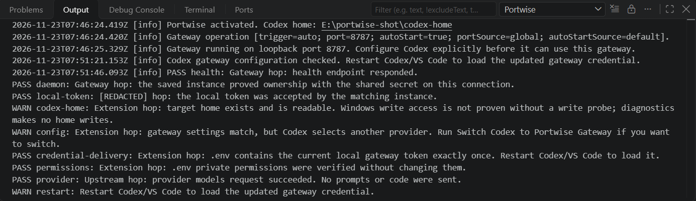

# Diagnostics screenshot

This is a real maintainer-supplied capture from the 0.1.1 Marketplace build, using an isolated profile and a fake provider. The original PNG is preserved without editing.

Captured result: **6 PASS, 3 WARN, 0 FAIL**. Health, daemon, local-token, credential-delivery, permissions and provider pass. Codex-home, config and restart warn. A generic isolated test-home path and redacted field label are visible; no email or credential value is shown. These are the actual warning rows, not a fabricated all-green result.

This page used to be a capture placeholder. It remains as a landing page for older release README links; the current README embeds the PNG directly.

[Back to README](../../README.md#screenshots)
