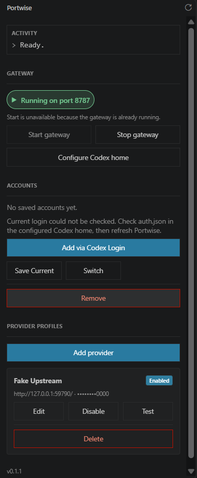

# Panel screenshot

This is a real maintainer-supplied capture from the 0.1.1 Marketplace build, using an isolated VS Code profile and a fake provider. The original PNG is preserved without editing.

The gateway is Running on port 8787; the Fake Upstream provider is Enabled. The account area has no saved accounts. Only a masked fake-key suffix is shown; no email or credential value is visible.

This page used to be a capture placeholder. It remains as a landing page because older release READMEs link here. The current README embeds the PNG directly.

[Back to README](../../README.md#screenshots)
